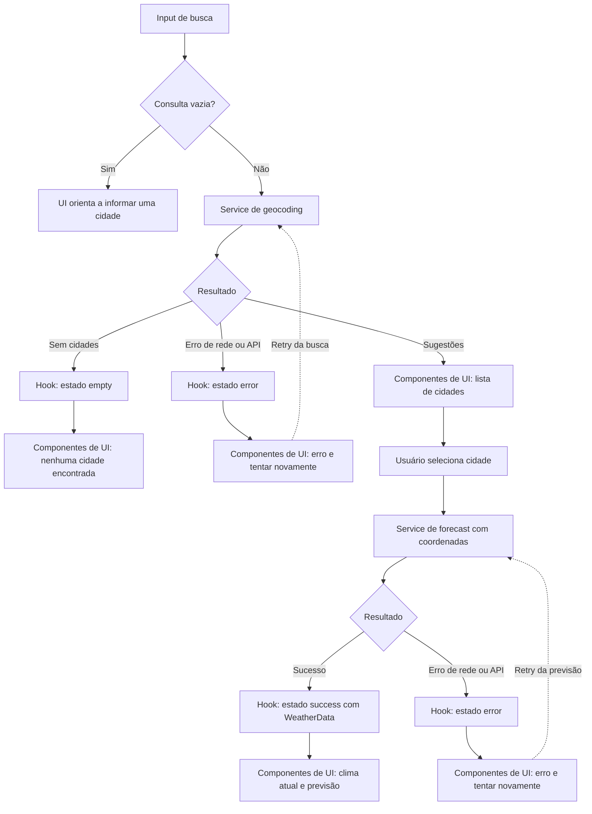

# Plano Técnico — Weather App

Fonte da verdade: [especificação do produto](../specs/weather-app-spec.md). Este plano define arquitetura e contratos para RF-01 a RF-05 e RNF-01 a RNF-06; não é a implementação.

## Architecture

SPA React, organizada em camadas com responsabilidades e dependências explícitas:

```text
components/  apresentação: entrada, resultados, controles e estados visuais
     ↓ usa
hooks/       orquestração: estado da tela, eventos e chamadas aos serviços
   ↙   ↘
services/   lib/
HTTP e      funções puras de normalização,
adaptação   conversão e mapeamento
   ↓
Open-Meteo
```

- **`components/`** recebe valores e callbacks, renderiza a UI e acessibiliza as interações. Não conhece endpoints nem executa requisições.
- **`hooks/`** coordena busca, seleção, carregamento, erro, retry e unidade de temperatura; chama serviços e fornece dados/ações à apresentação. O clima só é solicitado após seleção explícita de uma cidade.
- **`services/`** encapsula chamadas HTTP à Open-Meteo e adapta respostas externas para os tipos do domínio. Não depende de React ou dos componentes.
- **`lib/`** contém funções determinísticas sem efeitos colaterais, como normalização de consulta, conversão de temperatura, formatação e mapeamento de códigos meteorológicos.

`App` compõe componentes e conecta-os ao hook da tela. A unidade de origem permanece Celsius; os valores são convertidos localmente quando exibidos. Essa direção de dependências permite testar a interface, o estado/orquestração, o contrato HTTP e as regras puras separadamente, sem mocks de rede para testar funções nem renderização para testar o serviço. O build continua estático, sem servidor próprio ou segredo de API (RF-01 a RF-05, RNF-05).

## Tech Stack

| Tecnologia | Uso e justificativa |
|---|---|
| TypeScript strict | Contratos explícitos entre serviços, estado e interface; reduz erros no tratamento de respostas parciais. |
| React 19 | SPA e composição de componentes para busca, clima atual e previsão. |
| Vite 8 | Desenvolvimento e build estático; configurar o caminho-base do projeto para publicação no GitHub Pages. |
| Tailwind CSS 3 | Estilo responsivo mobile-first e tema dark glassmorphism conforme a interface definida. |
| Vitest + Testing Library | Testes unitários e de componentes com respostas controladas. |
| Playwright | Testes E2E do fluxo real da interface, responsividade e estados. |
| Biome | Lint e formatação nos diretórios de código e testes. |
| Open-Meteo | Geocoding e previsão sem chave de API. |

As versões correspondem às dependências já declaradas em `package.json`. A interface e as mensagens são pt-BR; a unidade padrão é Celsius e não há persistência da escolha entre visitas (RNF-01, RNF-05, RNF-06).

## Project Structure

Estrutura proposta para a implementação:

```text
src/
  components/
    CitySearch.tsx        # Campo, sugestões e seleção explícita
    CurrentWeather.tsx    # Condições atuais e valores
    Forecast.tsx          # Cinco dias de previsão
    UnitToggle.tsx        # Alternância °C/°F acessível
    WeatherStates.tsx     # Apresentação de loading, vazio e erro
  hooks/
    useWeather.ts         # Estado e orquestração da busca e do clima
  services/
    openMeteo.ts          # Chamadas HTTP e adaptação de respostas externas
  lib/
    temperature.ts        # Conversão e formatação de temperatura
    search.ts             # Normalização de consulta
    weatherCode.ts        # Mapeamento de códigos para condições pt-BR
  types/
    weather.ts            # Tipos de domínio compartilhados
  App.tsx                 # Composição e coordenação da tela
tests/
  unit/                   # Testes próximos às respectivas camadas
    lib/                  # Regras puras, sem mocks
    services/             # HTTP/adaptação com fetch controlado
    hooks/                # Transições de estado com serviços mockados
    components/           # Renderização e interações acessíveis
  e2e/                    # Fluxos completos com Playwright
```

As dependências seguem uma única direção: componentes → hooks → services/lib; serviços e `lib` não importam componentes ou hooks. `lib` permanece pequeno e reservado a lógica pura compartilhável, sem criar uma camada genérica de utilitários. Os testes podem espelhar essas fronteiras: cobrir cálculos e normalização diretamente, testar serviços com respostas HTTP controladas, exercitar hooks com serviços substituídos e verificar componentes por comportamento visível e acessível. E2E cobre o fluxo completo, não substitui os testes isolados (RF-01 a RF-05, RNF-03, RNF-04).

## Data Model

Tipos de domínio propostos. Valores meteorológicos podem ser `null` quando a API os omitir; a apresentação os exibe como `—` sem descartar os demais campos.

```ts
export type Unit = "celsius" | "fahrenheit";

export interface City {
  id?: number;
  name: string;
  latitude: number;
  longitude: number;
  region?: string;
  country?: string;
}

export interface CurrentWeather {
  temperatureC: number | null;
  weatherCode: number | null;
  humidityPercent: number | null;
  windKmh: number | null;
  pressureHpa: number | null;
  precipitationMm: number | null;
}

export interface ForecastDay {
  date: string; // Data local da cidade, formato ISO YYYY-MM-DD
  minTemperatureC: number | null;
  maxTemperatureC: number | null;
  weatherCode: number | null;
  precipitationMm: number | null;
}

export interface WeatherData {
  city: City;
  timezone: string;
  current: CurrentWeather;
  forecast: ForecastDay[]; // Exatamente hoje e os quatro dias seguintes
}
```

Os valores de temperatura no domínio permanecem em Celsius independentemente da unidade exibida. Campos obrigatórios para identificar uma cidade selecionável (nome e coordenadas válidas) são validados na adaptação da resposta; contexto de região/país pode estar ausente. As datas da previsão vêm da API no fuso local retornado, não são calculadas no navegador (RF-01, RF-02, RF-03, RF-04, AC-07, AC-09).

## Data Flow



1. A pessoa informa uma cidade. Espaços externos são removidos e a consulta é normalizada para que caixa e acentos não criem buscas diferentes.
2. A busca vazia é validada na interface: mostrar orientação sem chamar nenhuma API. Caso contrário, o serviço consulta geocoding e adapta resultados válidos para `City`.
3. Sugestões exibem cidade e, quando disponíveis, região e país. Nenhuma seleção ocorre automaticamente; selecionar uma opção define a cidade ativa.
4. Só então o serviço busca a previsão pelas coordenadas selecionadas. A resposta é adaptada para `WeatherData`; campos nulos/ausentes viram `null`, e datas não são inventadas nem deslocadas.
5. O estado de sucesso alimenta os componentes de clima atual e previsão. Uma alteração de unidade recalcula apenas os valores de exibição a partir de Celsius, sem nova chamada de rede.
6. Retry repete a mesma operação que falhou (geocoding ou previsão), usando a consulta ou cidade selecionada que originou a falha (RF-01 a RF-05, AC-03 a AC-15).

## External APIs

### Geocoding

- Endpoint: `https://geocoding-api.open-meteo.com/v1/search`
- Parâmetros: `name` com a consulta normalizada; `count` para limitar sugestões; `language=pt` para nomes localizados quando disponíveis; `format=json`.
- Campos usados: `id`, `name`, `latitude`, `longitude`, `admin1` (região/estado) e `country`.
- Resposta sem resultados é um estado vazio, não erro. Resultados sem nome ou coordenadas utilizáveis não viram sugestões selecionáveis.
- Exemplo resumido:

  ```json
  {
    "results": [
      {
        "id": 3448439,
        "name": "São Paulo",
        "latitude": -23.55,
        "longitude": -46.63,
        "admin1": "São Paulo",
        "country": "Brasil"
      }
    ]
  }
  ```

- Mapeamento: cada item de `results` vira um `City`: `id`, `name`, `latitude` e `longitude` são copiados; `admin1` vira `region` e `country` permanece `country`. Geocoding não fornece `current`, `daily` ou `timezone`; esses dados pertencem à consulta de previsão.

### Forecast

- Endpoint: `https://api.open-meteo.com/v1/forecast`
- Parâmetros: `latitude` e `longitude` da cidade escolhida; `current=temperature_2m,relative_humidity_2m,weather_code,wind_speed_10m,surface_pressure,precipitation`; `daily=weather_code,temperature_2m_min,temperature_2m_max,precipitation_sum`; `temperature_unit=celsius`; `wind_speed_unit=kmh`; `precipitation_unit=mm`; `timezone=auto`; `forecast_days=5`.
- Exemplo resumido:

  ```json
  {
    "timezone": "America/Sao_Paulo",
    "current": {
      "temperature_2m": 22.4,
      "relative_humidity_2m": 68,
      "weather_code": 2,
      "wind_speed_10m": 10.8,
      "surface_pressure": 1013.2,
      "precipitation": 0
    },
    "daily": {
      "time": ["2026-11-06", "2026-11-07"],
      "weather_code": [2, 61],
      "temperature_2m_min": [17.1, 18.0],
      "temperature_2m_max": [25.3, 23.8],
      "precipitation_sum": [0.0, 4.2]
    }
  }
  ```

- Mapeamento para `WeatherData`: associe a cidade selecionada em `city` e `timezone` à zona retornada; mapeie `current.temperature_2m` → `temperatureC`, `relative_humidity_2m` → `humidityPercent`, `weather_code` → `weatherCode`, `wind_speed_10m` → `windKmh`, `surface_pressure` → `pressureHpa` e `precipitation` → `precipitationMm`.
- Monte `forecast` pareando por índice as séries diárias: `time` → `date`, `temperature_2m_min` → `minTemperatureC`, `temperature_2m_max` → `maxTemperatureC`, `weather_code` → `weatherCode` e `precipitation_sum` → `precipitationMm`. Embora o exemplo seja abreviado, a requisição `forecast_days=5` deve retornar cinco datas para atender à spec. Códigos WMO são traduzidos para condições em pt-BR pela aplicação, não pela API.
- A aplicação solicita sempre temperaturas em Celsius e faz a conversão local. Respostas HTTP inválidas, falhas de rede e timeout são erros; valores meteorológicos individuais ausentes ou nulos são preservados como `null`. A resposta deve fornecer as cinco datas requeridas no fuso retornado, sem fabricar dados para completar séries incompletas (RF-02, RF-03, RF-04, RF-05).

## State Management

O estado da tela vive em um hook React (`useWeather`), consumido pelo `App` e passado aos componentes por props e callbacks. Não há estado global, biblioteca adicional nem persistência; a unidade começa em Celsius a cada visita. O hook orquestra as operações, enquanto os componentes apenas apresentam o estado e emitem ações.

Busca e consulta meteorológica têm estados independentes. Cada operação segue estados explícitos; `empty` é resultado válido de geocoding sem cidades e não se aplica a uma falha:

```ts
type SearchState =
  | { status: "idle" }
  | { status: "loading"; query: string }
  | { status: "success"; query: string; cities: City[] }
  | { status: "empty"; query: string }
  | { status: "error"; query: string; message: string };

type WeatherState =
  | { status: "idle" }
  | { status: "loading"; city: City }
  | { status: "success"; report: WeatherData }
  | { status: "error"; city: City; message: string };
```

Além desses estados, o hook mantém a consulta editável, a cidade selecionada e `Unit` (inicializada como `"celsius"`). Busca válida inicia `SearchState.loading`; conclusão com resultados produz `success`, sem resultados produz `empty`, e falha produz `error`. Selecionar uma cidade inicia `WeatherState.loading`; conclusão produz `success` ou `error`. Inatividade inicial ou ausência de consulta meteorológica usa `idle`.

Os dados do relatório permanecem em Celsius, conforme `WeatherData`. A unidade selecionada é estado de apresentação; a renderização deriva cada temperatura atual e prevista: para Fahrenheit, `°F = (°C × 9/5) + 32`; para Celsius, exibe o valor original. Valores `null` permanecem ausentes e são apresentados como `—`. Alternar a unidade não altera a cidade nem o relatório, não requer estado duplicado de temperatura e não dispara requests. Requisições obsoletas devem ser canceladas ou ignoradas para que respostas fora de ordem não substituam a consulta/cidade atual (RF-04, AC-10, AC-11).

## Error Handling

- **Rede:** rejeição de `fetch`/desconexão encerra o loading e leva a operação ao estado `error`, com mensagem pt-BR e ação “Tentar novamente”; não mostrar a falha como dado.
- **API/HTTP:** respostas HTTP não exitosas e erros reportados pela API são falhas recuperáveis; preservar contexto da operação para que retry repita a busca de geocoding ou a consulta meteorológica correspondente.
- **Timeout:** limitar a duração da requisição usando `AbortController`/timer no serviço. Timeout deve seguir o mesmo fluxo de erro recuperável; cancelamento por uma requisição mais recente não deve exibir uma mensagem de falha ao usuário.
- **Resposta parcial:** medidas individuais ausentes ou nulas são representadas por `null` no modelo e `—` na UI; campos válidos continuam disponíveis. Datas não devem ser inventadas ou deslocadas. Resposta sem estrutura essencial ou sem as cinco datas requeridas não é sucesso parcial: é erro da consulta.
- **Vazio e loading:** geocoding bem-sucedido sem resultados vai a `empty`, distinto de `error`. Toda requisição pendente apresenta `loading`, que sempre termina em sucesso, vazio ou erro.
- **Acessibilidade:** comunicar erros e mudanças de estado de forma acessível; oferecer controles com labels, foco visível e suporte a teclado (AC-03 a AC-15, RNF-03, RNF-04).

## Testing Strategy

Testes usam fixtures controladas e não dependem da disponibilidade da Open-Meteo nem de previsões variáveis.

### Vitest + Testing Library

- **Funções puras em `lib/`:** cobrir conversão Celsius/Fahrenheit nos dois sentidos (incluindo valores nulos), normalização da busca com espaços, caixa e acentos, formatação e mapeamento de códigos WMO. Testar entradas e resultados diretamente, sem mocks.
- **Serviços em `services/`:** substituir `fetch` por respostas controladas para verificar URLs e parâmetros de geocoding/forecast, adaptação dos campos ao modelo, associação das séries diárias por data/índice e comportamento em resposta HTTP não exitosa, erro de rede, timeout e payload malformado/parcial.
- **Componentes em `components/`:** testar os estados visíveis de loading, erro, vazio e sucesso. Verificar que busca em branco não requisita; sugestões exigem seleção; dados ausentes aparecem como `—`; retry é acionável; toggle converte todas as temperaturas sem uma nova chamada de rede. Usar queries acessíveis da Testing Library.
- **Hooks em `hooks/`:** substituir os serviços para verificar transições `idle → loading → success/empty/error`, retry, seleção explícita e proteção contra respostas obsoletas.

### Playwright

- Interceptar geocoding e forecast com fixtures e percorrer busca → seleção de cidade → clima atual e cinco dias → alternância °C/°F, confirmando que a alternância não gera nova requisição.
- Cobrir geocoding sem resultados, falha de rede/API, retry e resposta meteorológica parcial, verificando mensagens e recuperação no navegador.
- Executar os fluxos essenciais em viewport mobile de 320 px (retrato e paisagem) e desktop; verificar que busca, sugestões, cartões e estados permanecem utilizáveis, sem rolagem horizontal impeditiva (RNF-01).
- Validar teclado, nomes acessíveis, foco visível e contraste com verificações automatizadas e revisão manual. Medir carga inicial inferior a 2 segundos no build de produção estático.

**CI:** `pnpm lint`, `pnpm build` e `pnpm test`; `pnpm test:e2e` executa a suíte de navegador. Os testes determinísticos cobrem critérios AC-01 a AC-15 e os requisitos RNF-01 a RNF-06.

## Risks & Trade-offs

| Decisão / trade-off | Alternativa considerada e motivo da escolha | Rastreabilidade |
|---|---|---|
| Usar Open-Meteo diretamente do cliente, sem backend nem chave | Um backend/proxy poderia centralizar cache e proteger integrações, mas adicionaria infraestrutura incompatível com a entrega estática simples; a API selecionada não exige segredo. | RNF-05 |
| Estado local em hook React, sem store global | Context/store global facilitaria estado compartilhado em várias rotas, mas a v1 tem uma única tela e não precisa dessa complexidade. | RF-01 a RF-05 |
| Celsius como unidade de origem e conversão somente na apresentação | Solicitar Fahrenheit novamente ou armazenar valores duplicados criaria requests/estado sujeito a inconsistência; conversão local garante alternância imediata e reversível. | RF-04, AC-10, AC-11 |
| Dividir em `components`, `hooks`, `services` e `lib` pequenos | Arquitetura em camadas mais elaborada (repositórios, casos de uso e injeção de dependência) seria possível, mas não se justifica para este escopo; separar responsabilidades já permite testes isolados. | RF-01 a RF-05 |
| Cinco dias e fuso fornecidos pela API, com `timezone=auto` | Calcular datas no fuso do navegador pode deslocar “hoje”; usar datas locais da resposta satisfaz o período da cidade. | RF-03, AC-08, AC-09 |
| Manter campos de medida ausentes como `null`; não fabricar dias ausentes | Descartar a resposta inteira por uma medida nula reduziria resiliência; completar datas/dados ausentes inventaria previsões. Assim, medidas parciais são exibidas como `—`, mas falta estrutural das cinco datas é erro. | RF-02, RF-03, RF-05 |
| Retry explícito sem fallback/cache offline | Cache ou retry automático poderia ocultar indisponibilidade, apresentar informação desatualizada ou consumir chamadas adicionais; a v1 comunica a falha e deixa a decisão ao usuário. | RF-05, RNF-04 |
| Testes E2E com APIs interceptadas e unitários por camada | Depender da API real tornaria testes instáveis; usar somente mocks em E2E não verificaria a composição do fluxo. Fixtures determinísticas no browser e unitários isolados equilibram confiança e rapidez. | AC-01 a AC-15, RNF-01, RNF-06 |
| Deploy estático no GitHub Pages | Hospedagem com servidor próprio permitiria processamento no servidor, mas adicionaria custo operacional sem requisito correspondente. | RNF-05 |
